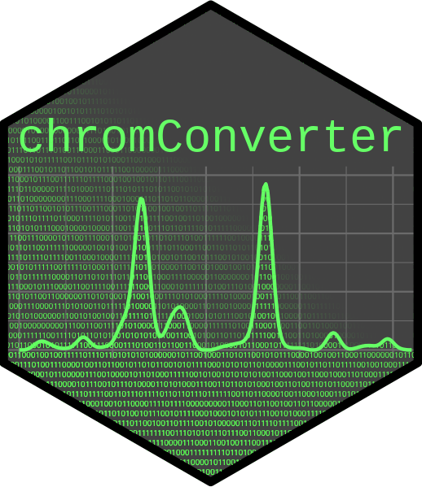

# chromConverter <a href='https://CRAN.R-project.org/package=chromConverter'></a>

<!-- badges: start -->
[](https://cran.r-project.org/package=chromConverter)
[](https://ethanbass.r-universe.dev/chromConverter)
[](https://github.com/ethanbass/chromConverter)
<br>
[](https://r-pkg.org/pkg/chromConverter)
[](https://cran.r-project.org/package=chromConverter)
<br>
[](https://doi.org/10.5281/zenodo.6792521)
<!-- badges: end -->

##### Table of contents
- [Overview](#overview)
- [Installation](#installation)
- [Quick Start](#quick-start)
- [File formats](#formats)
- [Usage](#usage)
- [Additional dependencies](#optional-dependencies)
- [See also](#see-also)
- [Contributing](#contributing)
- [Citation](#citation)

### Overview

chromConverter provides a simple way to read chromatography data into R from a variety of vendor formats. It includes parsers implemented directly in R as well as interfaces to various external tools including [Entab](https://github.com/bovee/entab), [rainbow](https://rainbow-api.readthedocs.io/), the [ThermoRawFileParser](https://github.com/compomics/ThermoRawFileParser), and [RaMS](https://github.com/wkumler/RaMS/).

We aim to support open science and reproducible research by reducing dependence on proprietary vendor software. Since most of the supported file formats are not publicly documented, many of the parsers are developed through reverse engineering. If you run into a file that doesn't parse correctly (or at all), please [open an issue](https://github.com/ethanbass/chromConverter/issues).

For downstream analysis of chromatographic data, see the companion package [chromatographR](https://ethanbass.github.io/chromatographR/).

### Installation

chromConverter can be installed from CRAN:

```r
install.packages("chromConverter")
```

However, it's recommended to install the development version, either from GitHub:

```r
if (!require("pak", quietly=TRUE)) install.packages("pak")
pak::pak("ethanbass/chromConverter")
```

or from [R Universe](https://r-universe.dev/):

```r
install.packages("chromConverter", repos="https://ethanbass.r-universe.dev/")
```

Some parsers require additional software. See [Optional Dependencies](#optional-dependencies) for details.

### Quick start

```r
library(chromConverter)

# Read a folder of Agilent ChemStation UV files
dat <- read_chroms("path/to/files", format_in = "chemstation_uv")
```

For a full example workflow, see the [Getting started](https://ethanbass.github.io/chromConverter/articles/chromConverter.html) vignette (`vignette("chromConverter")`).

### Formats

##### ChromConverter (internal parsers)
- Agilent ChemStation & OpenLab `.uv` files (versions 131, 31)
- Agilent ChemStation & OpenLab `.ch` files (versions 30, 130, 8, 81, 179, 181)
- Agilent ChemStation `.ms` and `.csv` files
- Agilent ChemStation sequence logs (`.LOG`), instrument traces (`LCDIAG.REG`) and methods (`.M`)
- Agilent OpenLab `.dx`, `.acaml`, `.amx`, and `.D` directories
- Agilent OpenLab `.rslt` sequence directories
- Allotrope® Simple Model (ASM) chromatograms, GC-MS spectra, peak lists and instrument traces (`.json`)
- ANDI (Analytical Data Interchange) Chromatography & MS formats (`.cdf`)
- mzML (`.mzml`) & mzXML (`.mzxml`) (via *RaMS*)
- Shimadzu LabSolutions ascii (`.txt`)
- Shimadzu GCsolution data files (`.gcd`)
- Shimadzu GCMSsolution data files (`.qgd`) 
- Shimadzu LabSolutions `.lcd` (PDA, QTOF, TLM (triple quadrupole MS), TIC, chromatogram, and peak table streams)
- Lumex `.mdf` files
- Thermo Scientific Chromeleon ascii (`.txt`)
- Varian Workstation (`.SMS`)
- Waters Empower ascii (`.arw`)
- Waters MassLynx `.raw` directories (2D chromatograms only)
- Chromatotec `.Chrom` files.

##### External Libraries

###### Entab (*Entab requires separate installation, see [instructions below](#optional-dependencies)*)
- Agilent ChemStation (`.ch`, `.fid`, `.ms`, `.mwd`, & `.uv`)
- Agilent MassHunter DAD (`.sp`)
- Thermo RAW (`.raw`)

###### ThermoRawFileParser (*requires separate installation, see [instructions below](#optional-dependencies)*)
- Thermo RAW (`.raw`)

###### rainbow
- Agilent (`.ch`, `.fid`, `.ms`, `.MSProfile.bin`, & `.uv`)
- Waters (`.raw` [UV, MS, CAD, ELSD])

### Usage

##### Importing chromatograms

The central function of chromConverter is `read_chroms`, a wrapper around all of the supported parsers. To convert a set of files, call `read_chroms`, specifying the `paths` to a vector of directories or files and the appropriate file format (`format_in`), such as `chemstation_uv`, `shimadzu_lcd`, `cdf` or `mzml`. See `?read_chroms` for the full list of values and [Formats](#formats) above for what each parser covers.

```r
library(chromConverter)
dat <- read_chroms(path, format_in = "chemstation_uv")
```

`read_chroms` chooses a parser and works out whether you've provided directories or files. To be explicit, set the `parser` and `find_files` arguments: `find_files = FALSE` means `paths` are files, and `find_files = TRUE` means they are directories to search.

###### Exporting files

To export the files as they are read, give the file format (`export_format`) and the directory to write them to (`path_out`). Reading Thermo RAW files or using `parser = "openchrom"` also writes files, so `read_chroms` asks for `path_out` in those cases too; if it is not given, you are offered a `temp` folder in the working directory.

```r
library(chromConverter)
dat <- read_chroms(path, find_files = FALSE, path_out = "temp",
                   export_format = "csv")
```

###### Choosing between multiple parsers

For formats where multiple parsers are available, you can choose between them using the `parser` argument. For example, Agilent files can be read by parsers from several external libraries, including Entab and rainbow. Some of these parsers must be installed manually as described in the [installation instructions](#optional-dependencies).

###### Working with the results

`read_chroms` returns a `chrom_list`, with files found in a directory sorted by acquisition time (see `sort_by`). Metadata are read by default and stored as [attributes](https://stat.ethz.ch/R-manual/R-devel/library/base/html/attributes.html) of each chromatogram. Printing a `chrom_list` shows the metadata rather than the data, and `summary` returns the same fields as a data frame along with each chromatogram's dimensions. `subset` selects chromatograms by their metadata, `attr` returns a single field, and `extract_metadata` collects every standard field into a data.frame or tibble:

```r
dat
summary(dat)
subset(dat, sample_name != "blank")
attr(dat[[1]], "run_datetime")
extract_metadata(dat)
```

`add_metadata(dat, sample_sheet)` attaches your own columns, such as treatment or dry weight, matched by sample name, so `subset` and `extract_metadata` can use them; [chromatographR](https://ethanbass.github.io/chromatographR/) carries them into `get_peaktable`.

##### Importing peak lists

The `read_peaklist` function imports peak lists from Agilent ChemStation REPORT (or `Result.xml`) files, Shimadzu ascii, `.lcd` and `.gcd` files, Chromatotec `.Chrom` files, and Allotrope Simple Model (ASM) files. The syntax is similar to `read_chroms`. In the simplest case, you can just provide paths to the files or directory you want to read in along with the format (`format_in`), e.g.

```r
pks <- read_peaklist(<path_to_directory>, format_in = "chemstation")
```

##### Reading instrument methods

`read_chemstation_method` reads the gradient, solvents and other instrument settings from Agilent ChemStation `.M` methods, including the copy a `.D` directory may hold. `read_shimadzu_method` reads the method stored in Shimadzu `.gcd`, `.lcd` and `.qgd` files, and `read_agilent_amx` reads Agilent OpenLab `.amx` methods.

```r
method <- read_chemstation_method("path/to/METHOD.M")
method$pump$gradient
```

The Shimadzu readers also attach the method's settings to each chromatogram as `method_params`, so `extract_metadata` can compare them across a sequence, e.g. `extract_metadata(dat, "method_params.column.name")`.

### Optional dependencies

Some of the parsers rely on external software libraries that must be manually installed.

##### **Entab**

[Entab](https://github.com/bovee/entab) is a Rust-based parsing framework for converting a variety of scientific file formats into tabular data. To use parsers from Entab, you must first install Rust and Entab-R. After following the [instructions](https://rust-lang.org/tools/install/) to install Rust, you can install Entab from GitHub as follows:

```r
pak::pak("bovee/entab/entab-r")
```

##### **ThermoRawFileParser**

Thermo RAW files can be converted by calling the [ThermoRawFileParser](https://github.com/compomics/ThermoRawFileParser) on the command-line. To install the ThermoRawFileParser, follow the instructions [here](https://github.com/compomics/ThermoRawFileParser). If you are running Linux or macOS, you will also need to install [mono](https://www.mono-project.com/download/stable/#download-lin), following the instructions provided at the link. In addition, when you use chromConverter to convert Thermo RAW files for the first time you will be asked to enter the path to the program.

##### **OpenChrom** 
###### **Note:** Support for the command-line interface was removed from OpenChrom in `version 1.5.0`. Version 1.4, which is required for command-line use, is no longer available for download. The instructions below are preserved for users who already have it installed.

[OpenChrom](https://lablicate.com/platform/openchrom) is free chromatography software containing a large number of file parsers, which can be called from R. Configuring OpenChrom for command-line use deactivates its graphical user interface (GUI), so keep a second copy of OpenChrom if you also want the GUI. To use the OpenChrom parsers, follow the steps below: 

1) [OpenChrom](https://lablicate.com/platform/openchrom/download) **version ≤ 1.4** is no longer available from Lablicate. If you have version 1.4 and use the command-line interface, keep a backup of it.
2) If you intend to use the GUI in the future, make a separate copy of OpenChrom for command-line use.
3) Call `read_chroms` with `parser = "openchrom"`. The first time you call the parser, you may be asked to provide the path to your local installation of OpenChrom. The path will then be saved for future use. If the command-line interface is disabled, you will be given the option to automatically activate the command-line.  Alternatively, the command-line option can be activated from R by calling `configure_openchrom(cli = "true")` or following the [instructions](https://github.com/OpenChrom/openchrom/wiki/CLI) to manually activate the CLI. This process can be reversed using the same function: e.g. `configure_openchrom(cli = "false")`. To specify an OpenChrom executable in a non-standard location, call `configure_openchrom` with the `path` argument, e.g. `configure_openchrom(cli = "true", path = "path_to_openchrom_executable")`.
4) Specify the detector category with `format_in`, since the OpenChrom parsers are organized by detector type rather than by file format: `csd` for current selective detectors (e.g. FID, ECD, NPD), `msd` for mass selective detectors, or `wsd` for wavelength selective detectors (e.g. DAD, UV/VIS).

### See also

- The [Getting started](https://ethanbass.github.io/chromConverter/articles/chromConverter.html) vignette shows how to read a sequence of standards from ChemStation, use the metadata to view and select runs, and fit a calibration curve to the peak tables.
- [Plotting mass spectrometry data](https://ethanbass.github.io/chromConverter/articles/plot_ms.html) introduces basic syntax for plotting MS data returned by chromConverter in base R, tidyverse and data.table.
- [chromatographR](https://ethanbass.github.io/chromatographR/) provides downstream analysis of chromatographic data.
- [ShinyChromViewer](https://github.com/ethanbass/ShinyChromViewer) (alpha release) provides interactive visualization of chromatograms.

### Contributing

Contributions of source code, ideas, or documentation are always welcome. Please get in touch (preferably by opening a GitHub [issue](https://github.com/ethanbass/chromConverter/issues)) to discuss any suggestions or to file a bug report. Some good reasons to file an issue:

- You think you've found a bug.  
- You're getting a cryptic error message that you don't understand.  
- You have a file format you'd like to read that isn't currently supported by chromConverter.  (Please make sure to attach example files or a link to the files).  
- There's another new feature you'd like to see implemented.  

**Note: Before filing a bug report, please make sure to install the latest development version of chromConverter from GitHub**, in case your bug has already been patched. After installing the latest version, you may also need to refresh your R session to remove the older version from the cache.

### Citation

You can cite chromConverter as follows:

`Bass, E. (2026). chromConverter: Chromatographic File Converter. https://doi.org/10.5281/zenodo.6792521`.

If you use external libraries to convert your files, please cite those libraries as well.
